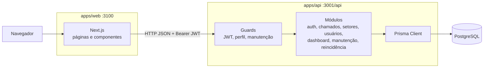

# Arquitetura

Visão da arquitetura implementada no OSQ-Resolve. As versões e os comandos estão em [stack](stack.md).

## Tecnologias por camada

| Camada | Tecnologia | Justificativa no projeto |
| --- | --- | --- |
| Interface | Next.js 16, React 19, TypeScript | Rotas por perfil (painel, chamados, cadastros) em um único front, com tipagem compartilhada no time |
| Interface | Tailwind CSS 4, shadcn/ui, Tremor, Sonner | Tela responsiva (RNF01), gráficos do painel (RF11) e avisos de erro das regras de negócio |
| Lógica | NestJS 11 | Módulos separam cada área do domínio; guards aplicam autenticação, perfil e manutenção em todas as rotas |
| Lógica | class-validator | Valida a entrada na fronteira da API (RN01, RN10) |
| Lógica | JWT, bcrypt, `@nestjs/throttler` | Autenticação com validade de 8 h, senhas com hash e limite de 5 tentativas por minuto em `/auth` (RF13, RNF04) |
| Persistência | PostgreSQL 18 | Banco relacional para os vínculos entre chamado, usuário, setor e histórico (RNF05) |
| Persistência | Prisma 6 | Esquema único e migrations versionadas no repositório |
| Integrações | HTTP/JSON entre front e API | O front não acessa o banco. **Não há integração com serviços externos**: e-mail, armazenamento de arquivos e notificações não existem |
| Ambiente | Execução local | Front em `:3100`, API em `:3001`, PostgreSQL em `:5432`. **O repositório não tem configuração de implantação nem de CI** |

## Diagrama



Toda regra de negócio é validada na API. O front esconde opções indisponíveis para o perfil, mas a API é quem decide.

## Organização de pastas

```
saas-dos-ti/
├── apps/
│   ├── web/src/
│   │   ├── app/(auth)/login/     Tela de login e cadastro da organização
│   │   ├── app/(app)/            Painel, chamados, novo chamado, detalhe, cadastros
│   │   ├── components/           Componentes (SLA, manutenção, reincidência, menu)
│   │   ├── components/ui/        Componentes base do shadcn/ui
│   │   └── lib/                  Cliente HTTP, sessão, rótulos e cálculo de SLA
│   └── api/
│       ├── src/                  Um módulo por área do domínio
│       └── prisma/               schema.prisma e migrations
├── docs/                         Requisitos, modelagem, backlog e entrega
│   └── testes/                   Roteiro da API e evidências
└── entrega-2-osq-resolve/        Documento da Entrega 2
```

## Onde mexer

| Para alterar | Arquivo |
| --- | --- |
| Uma tela | `apps/web/src/app/(app)/<rota>/page.tsx` |
| Menu e botões do cabeçalho | `apps/web/src/components/app-shell.tsx` |
| Cálculo e exibição do SLA | `apps/web/src/lib/sla.ts`, `apps/web/src/components/sla.tsx` |
| Regras do chamado (transições, cancelamento, reabertura) | `apps/api/src/chamados/chamados.service.ts` |
| Validação de entrada do chamado | `apps/api/src/chamados/chamados.dto.ts` |
| Autenticação e perfis | `apps/api/src/common/auth.ts`, `apps/api/src/auth/` |
| SLA padrão de uma nova organização | `apps/api/src/auth/auth.service.ts` |
| Tabelas e colunas | `apps/api/prisma/schema.prisma` + nova migration |
| Testes | `docs/testes/executar-casos-api.mjs`, `docs/casos-de-teste.md` |

## Decisões e limitações

- **Multitenancy (RNF08):** cada consulta filtra pela organização do usuário logado, que vem do banco a cada requisição, não do token. O número do chamado, porém, é uma sequência global: uma organização nova pode começar em #543.
- **Sessão:** o token fica no `localStorage` do navegador.
- **Limite de tentativas:** conta por IP e fica em memória. Se a API rodar atrás de proxy, é preciso ativar `trust proxy`, ou todos os usuários dividem o mesmo limite.
- **SLA:** só o prazo de resolução é usado. `minutosAtendimento` é gravado, mas nada o consome.
- **Modelo lógico:** a Entrega 2 descreve tabelas `tecnico`, `categoria` e `prioridade` e ids inteiros. O implementado usa perfil e enumerações, com ids UUID, conforme o [modelo conceitual](modelo-conceitual.md).
